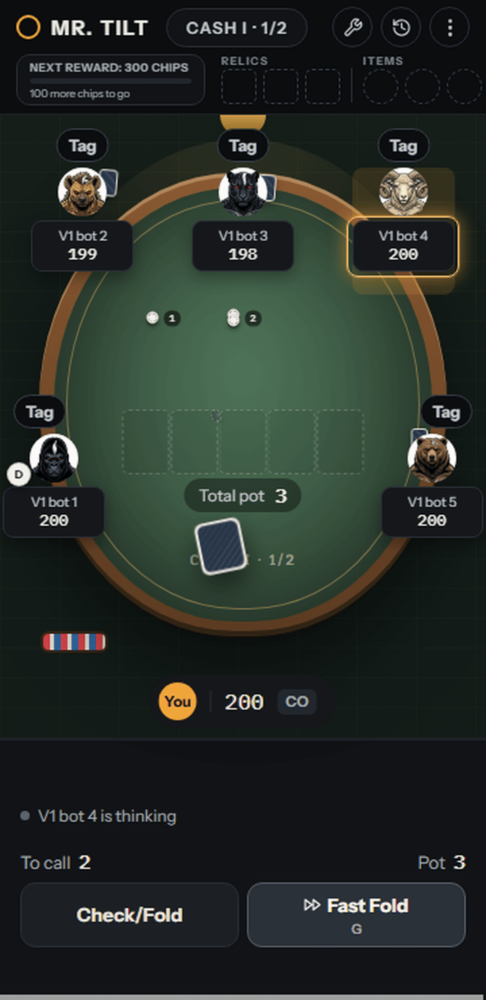
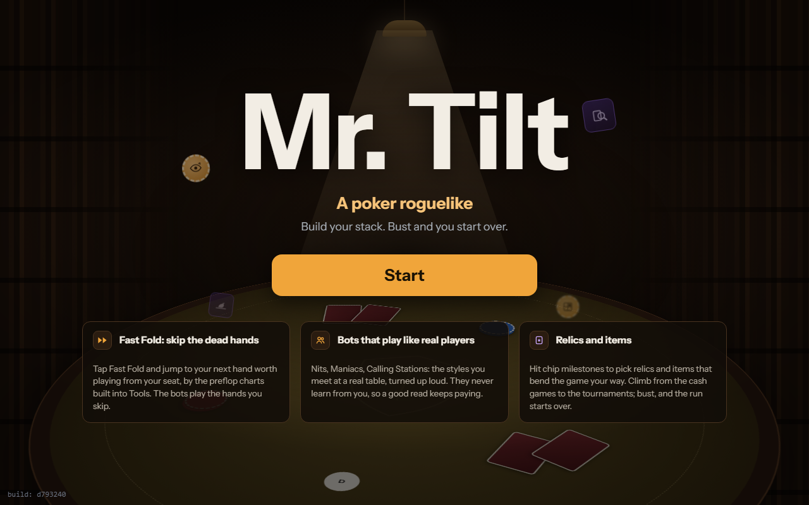
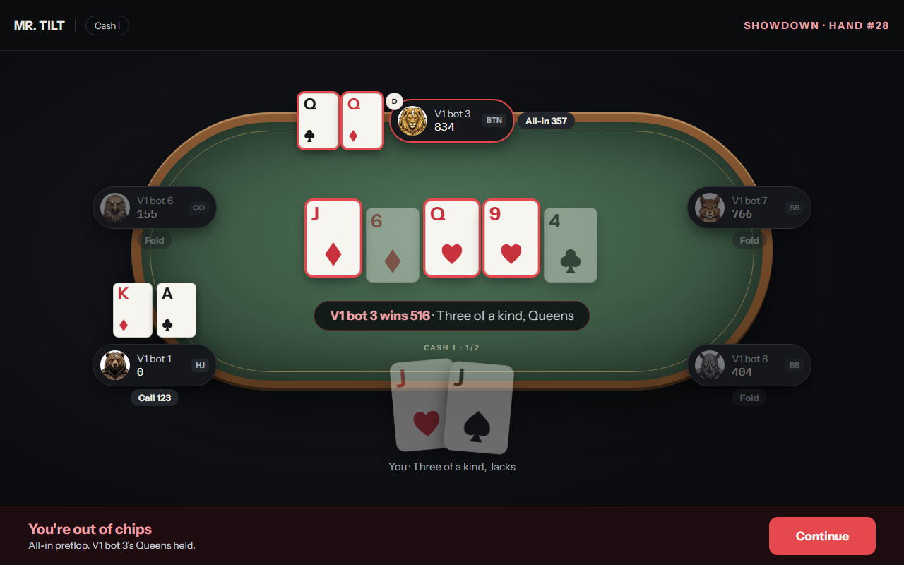
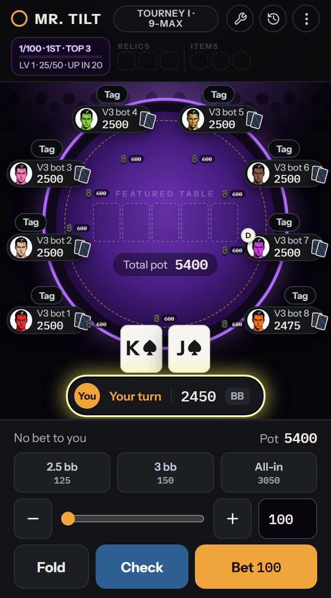

# Mr Tilt poker video game

A browser-based, offline single-player Texas Hold'em poker trainer built to help players develop GTO (Game Theory Optimal) decision-making at the table.

🎮 **Play it live:** [mr-tilt.vercel.app](https://mr-tilt.vercel.app/)

## What It Is

A 6-9max No-Limit Hold'em training simulator where you play against AI bots of scaling difficulty. The bots use solver-derived preflop ranges and a custom postflop decision engine to simulate realistic opponents, so you can practice hand reading, position play, bet sizing, and tournament ICM pressure without risking real money.

## Features

- **Cash Game and Tournament modes** with distinct strategy profiles
- **AI opponents** powered by a custom solver engine with GTO-informed preflop ranges and postflop decision trees
- **Dynamic blind structures** for tournament play with escalating pressure
- **Preflop range charts** sourced from real solver outputs across all positions (UTG through BB) at multiple stack depths (15bb, 25bb, 40bb, 60bb, 100bb)
- **Real-time hand evaluation** and showdown logic
- **Full table UI** with pot odds, stack sizes, position indicators, and action history

## Built With

- JavaScript / HTML / CSS
- Deployed on Vercel
- AI-assisted development using Claude Code

## About the Builder

I'm Richson Lim, a Senior Product Manager at Ticketmaster (Live Nation). I built this as a side project to sharpen my own poker game and to explore what it looks like to use AI development tools as a PM to ship a real product from idea to deployment.

The solver engine and bot logic are proprietary and kept in a private repository.

## Screenshots

## Contact

- LinkedIn: [linkedin.com/in/richson-lim-a71b88b7](https://www.linkedin.com/in/richson-lim-a71b88b7/)
- GitHub: [github.com/rodpiee](https://github.com/rodpiee)
